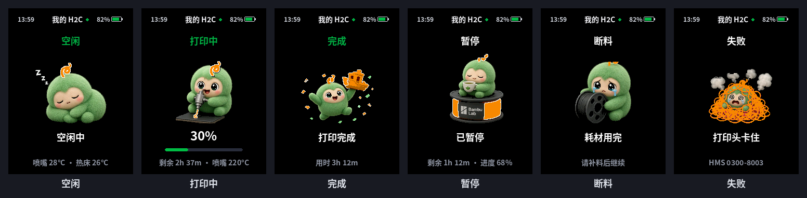
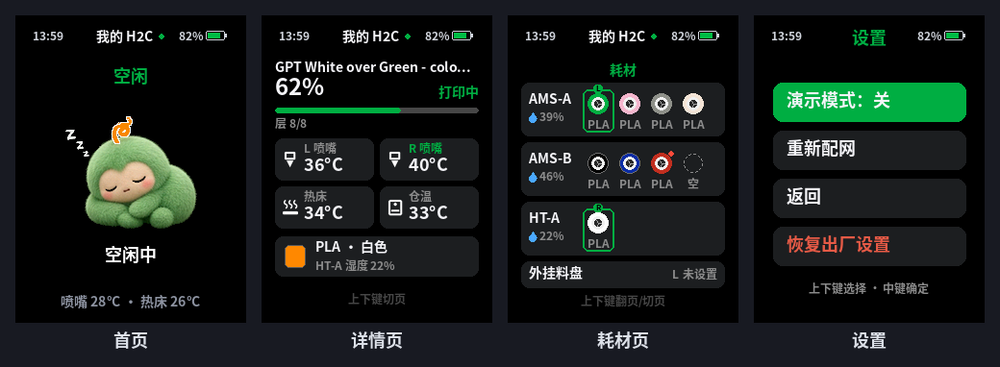

# 线线 · AI Passport 拓竹打印机状态萌宠

把 FoloToy **AI Passport** 工牌变成一只会跟着拓竹(Bambu Lab)打印机一起"上班"的毛绒小宠物「线线」。
它不是另一个参数面板,主要是陪伴感:打印机在干活,线线也在干活;打完了它举着小船庆祝;断料了它抱着空盘哭。



> 截图是电脑按固件布局渲染的效果图(和真机画面逐页比对过),顶部时间和电量是示例值。

## 功能

- **6 种状态,每种一套动画**
  | 状态 | 线线在做什么 |
  | --- | --- |
  | 空闲 | 趴着打盹,偶尔(每 3–6 分钟)伸个懒腰 |
  | 打印中 | 抱着喷嘴干活,下面的小船随真实进度一层层长高,显示进度和剩余时间 |
  | 完成 | 举着小船庆祝,显示用时;按一下中键"收下",会冒爱心 |
  | 暂停 | 坐在耗材盘上喝茶 |
  | 断料 | 抱着空料盘哭 |
  | 失败 | 被乱丝缠住,显示 HMS 错误码 |
- **耗材颜色跟随**:线线的毛色跟着当前正在用的耗材颜色变;没装耗材时用灰色。
- **顶部状态栏**:每一页左上角显示时间(北京时间,联网对时前显示 `--:--`),右上角显示工牌电量(20% 及以下变红)。
- **详情页**:任务名、进度、层数、喷嘴温度(双喷嘴分左右)、热床、仓温、当前耗材。
- **耗材页**:按打印机实际接的 AMS / AMS 2 Pro / AMS HT 数量动态排版,显示每个槽的颜色和材质、余量低提示,以及每台 AMS 的湿度;正在出料的槽是绿框(双喷嘴机型带 L/R 标签);一屏放不下时上下键页内翻。
- **多台打印机**:一个账号下最多选 4 台。某台断料、失败或完成时,停 3 秒后自动切过去。
- **演示模式**:不用连打印机也能看全部状态,适合展示和拍视频。
- **登录与安全**:手机扫码配网,验证码登录拓竹账号;工牌只保存 token,**从不接触你的拓竹密码**;只直连拓竹服务器,不经过任何第三方服务器。
- **低内存稳定**:ESP32-C3 没有 PSRAM,而 H2C 的一条全量报文就有 12–22 KB。固件对 MQTT 分片做流式过滤,不缓冲整条报文。v4.7.1 实测最低剩余内存约 44–49 KB,长时间运行没有死机或看门狗重启。



## 按键

工牌有三个键:上、中、下。中键是确定键。

| 操作 | 作用 |
| --- | --- |
| 上 / 下 | 切页:首页 → 详情页 → 耗材页 → 首页 |
| 单击中键 | 首页在「完成」时先收下庆祝;其他时候翻到下一页 |
| 双击中键 | 换下一台打印机(绑定了 2 台以上才有) |
| 长按中键(约 0.5 秒) | 打开设置:演示模式开关 / 重新配网 / 返回 / 恢复出厂设置 |
| 设置里 上 / 下 / 中键 | 选择 / 选择 / 确定 |
| 演示模式里单击中键 | 换下一个状态(1/6 → 6/6) |
| 恢复出厂确认页 | 松开后再按住中键 5 秒才清除;中途松手或按上/下就取消 |

## 硬件要求

- **FoloToy AI Passport** 工牌:ESP32-C3(无 PSRAM)、8 MB Flash、240×320 屏、三个按键、CW2017 电量计。
- **拓竹打印机**,已绑定到**拓竹中国区账号**(固件连的是 `api.bambulab.cn` 和 `cn.mqtt.bambulab.com`)。开发时用 H2C + AMS HT + 两台 AMS 2 Pro 实机测试,另用公开的 H2D 报文做了回放测试;X1 / P1 / A1 系列按报文格式做了兼容,但没有实机测试。
- 2.4 GHz Wi-Fi(ESP32-C3 不支持 5 GHz)。
- 一台装了 Chrome 或 Edge 的电脑和一根能传数据的 USB-C 线(用来刷机)。

## 快速开始

1. 到 [Releases](../../releases) 下载 `webflash-v4.7.2.zip` 并解压。
2. 在解压出的目录里运行 `python3 -m http.server 8000`,用 Chrome 打开 <http://localhost:8000>。
3. 点「全新安装」,选工牌的串口,等 1–2 分钟。
4. 工牌重启后屏幕上有二维码。用手机扫码连上热点 `Passport-XXXX`,在弹出的网页里选家里的 Wi-Fi、填拓竹账号收验证码、勾选打印机。
5. 绑定成功后工牌自动重启,线线就开始陪你的打印机上班了。

详细步骤见:

- [刷机步骤](docs/flashing.md):网页刷机、esptool 命令行、只更新应用并保留配网
- [首次配网与拓竹登录](docs/setup.md)
- [从源码构建](docs/build.md)
- [常见问题](docs/faq.md)
- [已知限制与规划](docs/limitations.md)
- [更新记录](CHANGELOG.md)

## 仓库结构

```
main/            固件源码(宠物逻辑、界面、拓竹云、配网门户、状态栏)
main/assets/     生成好的帧图、字库、配网网页(构建直接用,无需重新生成)
components/bsp/  工牌板级驱动(来自 FoloToy/ai-passport)
art/             宠物帧图源文件和配网网页源文件,用 tools/pet/gen_assets.py 重新生成 main/assets
tests/           主机单元测试和报文样例
tools/           validate.sh(测试 + 构建)、make_release.sh、NVS 工具
webflash/        网页刷机页面(ESP Web Tools),二进制从 Release 下载
docs/            文档和截图
```

## 声明

- 本项目是个人开源作品,**与拓竹(Bambu Lab)、FoloToy 官方无关**,未获得其认可。Bambu Lab、拓竹、AMS 是 Bambu Lab 的商标;FoloToy、AI Passport 是 FoloToy 的商标。
- 固件用的拓竹云接口来自社区逆向,不是官方公开 API,随时可能变化。使用风险自负。
- 宠物「线线」的美术素材是 AI 生成后人工修整的,授权方式见 [THIRD_PARTY_NOTICES.md](THIRD_PARTY_NOTICES.md)。
- 源代码以 [MIT](LICENSE) 许可证发布。板级驱动和工程框架基于 [FoloToy/ai-passport](https://github.com/FoloToy/ai-passport)(MIT)。

---

## English (short)

**Xianxian** is a plush "filament-yarn" desk pet for the FoloToy AI Passport badge (ESP32-C3, no PSRAM, 240×320, 3 keys).
It mirrors your Bambu Lab printer over the Bambu **China** cloud: it naps when idle, works while printing (a boat grows with real progress),
lifts the boat when done, sips tea on pause, cries over an empty spool on run-out, and gets tangled on failure. Its colour follows the active filament.
Every page shows the time and the badge battery. There is a detail page, an AMS page that adapts to the attached AMS units (active slot outlined in green),
up to 4 printers, and a demo mode.

Setup is done from your phone: scan the QR code, join the `Passport-XXXX` hotspot, pick your Wi-Fi, and log in with a Bambu verification code.
Only the access token is stored on the badge; your Bambu password is never entered, and the badge talks only to Bambu's servers (plus an NTP server).

Flash it from Chrome/Edge with the web flasher in the release zip, or with `esptool` (see [docs/flashing.md](docs/flashing.md)). Build with ESP-IDF 5.5.3.

This is an unofficial hobby project, **not affiliated with or endorsed by Bambu Lab or FoloToy**. Source code: MIT. Pet artwork: see THIRD_PARTY_NOTICES.md.
