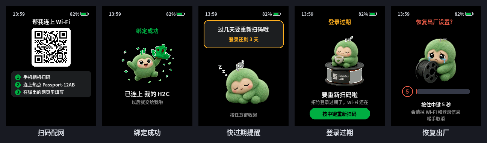

# 首次配网与拓竹账号登录

只需要做一次。之后断网、断电、重启,工牌都会自己重连。

## 步骤

1. **开机看二维码**:没配过网的工牌开机后进入配网页,屏幕上有一个二维码,下面写着热点名 `Passport-XXXX`(XXXX 是这块工牌 MAC 地址的后 4 位,每块不一样)。
2. **手机连热点**:用手机相机扫二维码,手机会加入这个热点(开放热点,不需要密码)。扫不了就去手机的 Wi-Fi 设置里手动连 `Passport-XXXX`。
3. **打开配网网页**:手机一般会自动弹出配网页面。没弹出来就用浏览器打开 `http://192.168.4.1`。
4. **① 连接 Wi-Fi**:选家里的 **2.4 GHz** Wi-Fi,填密码。
5. **② 登录拓竹账号**:填拓竹账号的手机号或邮箱,点「获取验证码」,把收到的验证码填进去。
   这一步工牌会先连上你家的 Wi-Fi,再去访问拓竹服务器。
6. **③ 选择打印机**:网页会列出账号下的全部打印机(绿点表示在线)。最多勾 4 台,第一台是开机默认显示的那台。点「完成绑定」。
7. 工牌显示「绑定成功」,几秒后自动重启,然后就会一直自动连接。

小提示:工牌连上家里 Wi-Fi 时,热点的信道可能跟着变,手机可能会断开一下。网页提示出错的话,重新连上热点、刷新页面再试一次。

## 工牌里存了什么、连了哪里

- **拓竹密码从来不经过工牌**:登录用的是验证码,网页里没有密码框。
- 工牌在自己的 NVS 分区(命名空间 `petcfg`)里保存:
  - 家里 Wi-Fi 的名称和密码(连网必须用);
  - 拓竹账号的用户 ID、access token、refresh token 和过期时间;
  - 选中的打印机序列号、名称和型号。
- 工牌只连这几个地方,没有任何第三方中转服务器:
  - `api.bambulab.cn`(HTTPS):发验证码、登录、拉打印机列表、续期 token;
  - `cn.mqtt.bambulab.com:8883`(MQTT over TLS):订阅打印机状态;
  - `ntp.aliyun.com`:对时,只用来显示时间。
- 串口日志里不会打印 token、序列号、Wi-Fi 密码,只打印「set / -」。
- NVS 没有加密。工牌丢了或者要送人,先做一次恢复出厂设置。

## 登录过期

- 固件每 6 小时检查一次,离过期不到 7 天就在后台自动续期;MQTT 被拒绝时也会先尝试续期。
- 剩 1–3 天时,每天第一次检查会弹一张黄色便签「过几天要重新扫码哦」,按任意键收起。
- 续期失败或已经过期,屏幕显示「要重新扫码啦」。按一下中键,屏幕出现二维码,按上面的步骤连热点,网页里只要重新收一次验证码,Wi-Fi 和打印机都保留。

## 方案 B:局域网模式(不用拓竹账号)

如果验证码登录被拦(比如要过滑块或二次验证),可以让工牌直接连局域网里的打印机:

1. 在打印机屏幕上打开局域网模式(设置 → 网络),记下 **IP** 和 8 位 **访问码**;**序列号 SN** 在 设置 → 设备 里。建议在路由器里给打印机固定 IP。
2. 配网网页第 ① 步照常选 Wi-Fi(必须和打印机在同一个局域网)。跳过第 ②③ 步,展开最下面的「高级 · 用局域网连接」,填 IP、访问码、SN,点「用局域网绑定」。
3. 工牌重启后直连 `mqtts://<IP>:8883`(用户名 `bblp`,密码是访问码)。打印机用的是自签名证书,所以只有这条连接跳过证书校验;拓竹云和 HTTPS 仍然校验证书。

局域网模式只支持一台打印机,离开家里的网络就看不到状态,也没有过期提醒。

## 重新配网

长按中键打开设置,选「重新配网」,屏幕出现二维码,按上面的步骤重新来一遍。
